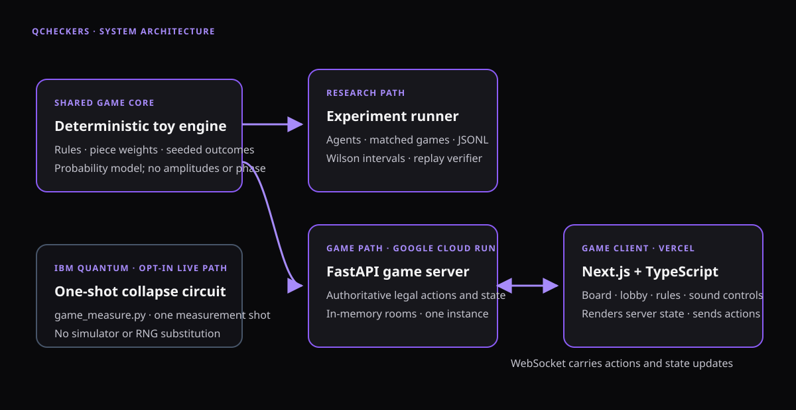
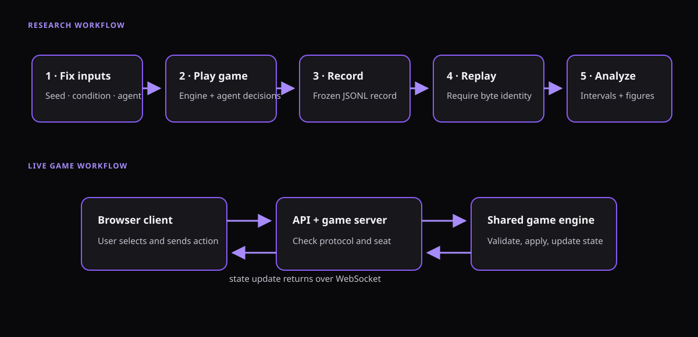
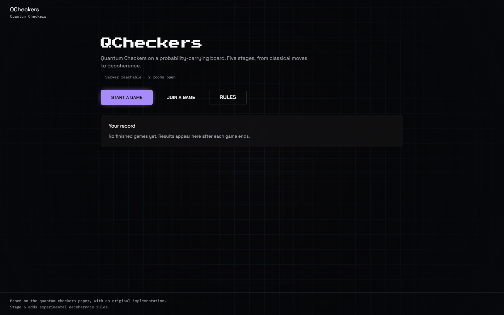
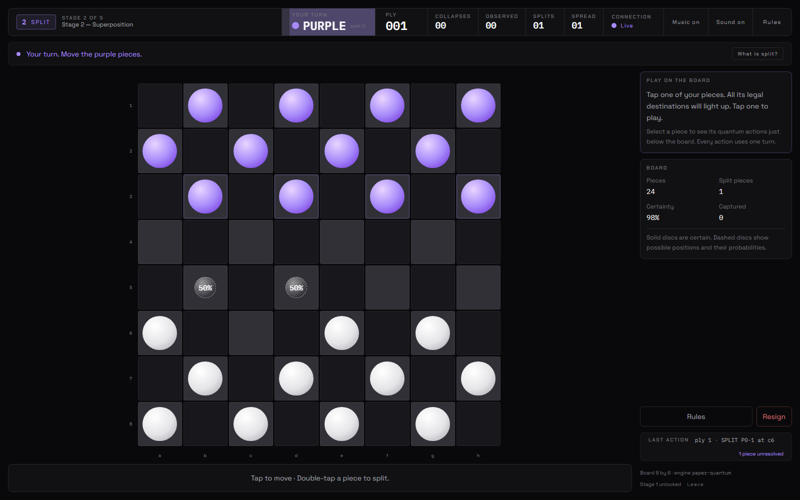

# QCheckers: A Playable Quantum-Inspired Checkers Game with One-Shot IBM Quantum Measurement

<div align="center">

**Project group:** QuriousMinds<br>
**Course:** IEG 313: Quantum Computing for Engineers<br>
**Department:** [Department name]<br>
**Institution:** [Institution name]<br>
**Academic year:** [Academic year]

**Institute logo:** [Insert the official institution logo here]

| Student name | Register number |
| --- | --- |
| [Student 1] | [Register number] |
| [Student 2] | [Register number] |
| [Student 3] | [Register number] |
| [Student 4] | [Register number] |
| [Student 5] | [Register number] |

**Instructor(s):** [Instructor name(s)]

**Submission date:** [Date]

</div>

---

## Abstract

QCheckers is a playable, server-authoritative checkers game. Each piece behaves like a
quantum state: it can occupy several squares at once, and the board is stored as a sparse
set of complex amplitudes over complete board configurations, evolved on the CPU. Levels
0–3 implement the staged rules of Raat *et al.* [1]: superposition with measurement,
entanglement, then interference. Level 4 is a project extension with a coherence timer
and a voluntary `Observe` action. Every collapse of uncertainty is encoded as a
measurement circuit. When IBM Quantum credentials are configured, the collapse is
resolved with one measurement shot on IBM hardware; a failed job or an unusable bitstring
refuses the move and leaves the state unchanged. The system includes a FastAPI and
WebSocket server, a Next.js client with a lobby, stage selection and reconnectable seats,
and a hosted deployment. The Python suite passes (449 tests on 19 October 2026), and the
client tests, typecheck and production build pass. The IBM boundary is tested against a
mock, and one real one-shot job on `ibm_fez` (19 October 2026) confirmed the hardware
path. The board state never runs on a QPU; the processor supplies one measurement sample
per collapse.

**Keywords:** quantum games, quantum checkers, complex amplitudes, measurement, IBM Quantum, web application

## Contents

1. [Introduction](#1-introduction)
2. [Literature review](#2-literature-review)
3. [Novelty](#3-novelty)
4. [Methodology and system design](#4-methodology-and-system-design)
5. [Implementation](#5-implementation)
6. [Results and discussion](#6-results-and-discussion)
7. [Conclusion and future work](#7-conclusion-and-future-work)
8. [Contributions](#8-contributions)
9. [References](#9-references)
10. [Appendices](#10-appendices)

### List of figures

1. [QCheckers system architecture](#figure-1-system-architecture)
2. [Game execution and collapse workflow](#figure-2-execution-workflow)
3. [QCheckers landing page](#figure-3-landing-page)
4. [QCheckers board after a split](#figure-4-game-board)

### List of tables

1. [Related work](#table-1-related-work)
2. [Project changes relative to the research anchor](#table-2-project-changes)
3. [Software and computing environment](#table-3-environment)
4. [Team contribution record](#table-4-contributions)

### Abbreviations

| Abbreviation | Meaning |
| --- | --- |
| API | Application Programming Interface |
| CPU | Central Processing Unit |
| IBM | International Business Machines |
| IEEE | Institute of Electrical and Electronics Engineers |
| JSONL | JSON Lines record format |
| MCTS | Monte Carlo Tree Search |
| QPU | Quantum Processing Unit |
| UCT | Upper Confidence bounds applied to Trees |
| UI | User Interface |
| WebSocket | Persistent, bidirectional browser/server connection |

## 1. Introduction

Quantum games use rules or presentation to help players reason about quantum phenomena
[2]. Raat *et al.* introduced quantum checkers as a staged game: classical draughts
extended with superposition, measurement, entanglement and interference, studied with
simulated agents [1]. This project turns that design into a playable product. The board
state is an exact complex-amplitude simulation, and each collapse of uncertainty can be
resolved with one measurement shot on IBM Quantum hardware.

### 1.1 Problem statement and motivation

The reference paper defines the staged rules and analyses the game in simulation. It does
not provide a playable implementation or a hardware path. Building one raises three
problems: representing uncertain pieces without losing phase effects or correlations,
deciding when uncertainty collapses during play, and finding a useful role for real
hardware. A QPU cannot hold or evolve the whole board state in this design, but it can
supply one real measurement sample for one collapse. The work therefore aims at an
interactive way to experience the mechanics, a clearly bounded use of real hardware, and
an engineering exercise in state simulation, protocol authority and deterministic
verification.

### 1.2 Objectives

- Implement Levels 0 to 3 of the paper's staged quantum checkers, covering superposition
  with measurement, entanglement and interference, plus a project-defined Level 4 with a
  coherence timer and voluntary `Observe`.
- Maintain an exact sparse complex-amplitude state over complete labelled board
  configurations. Game probabilities are occupancy marginals (`|amplitude|²`), and each
  operation is bounded by a branch cap.
- Encode every collapse as a one-shot measurement circuit whose basis-state amplitudes
  are the square roots of the candidate probabilities, and map the measured bitstring
  back to a square.
- Provide an optional IBM Quantum sampler with one shot per collapse, explicit error
  codes and visible provenance, and no simulator or RNG substitution on that path.
- Deliver a server-authoritative browser game (FastAPI, WebSocket, Next.js) with a
  lobby, stage selection, reconnectable seats and a hosted deployment.
- Verify the system with the full test suite, a mocked IBM boundary, one recorded real
  job, and reproducible documentation.

### 1.3 Scope

The game is English draughts on an 8×8 board (configurable from 4 to 16) with Levels 0
to 4. The complex state is simulated on the CPU. IBM Quantum is used only to sample a
collapse, one shot per event, when credentials are configured. The project does not keep
the board state on a QPU, estimate full output distributions with many shots, run game
logic on hardware, benchmark agent strength, or include a user study. The hosted
deployment's engine revision has not been verified against this local source.

## 2. Literature review

### 2.1 Quantum games and educational mechanics

Piispanen *et al.* survey games that reference quantum physics or use quantum principles
and propose a framework for describing their perceivable, technological and
scientific-purpose dimensions [2]. Their taxonomy separates a game that teaches quantum
ideas from a game whose computation is itself quantum. This project follows that
distinction: the board state is classical simulation, and one narrow step, measurement
sampling, can execute on real hardware. Cantwell presents Quantum Chess as a game built
on unitary dynamics with superposition, entanglement and interference [3], an example of
a physically grounded design. Raat *et al.* integrate those phenomena into a staged board
game and study simulated play [1]; their rules are the direct basis of Levels 0 to 3
here.

### 2.2 Search for probabilistic games

UCT applies multi-armed bandit selection to Monte Carlo planning [4] and is the selection
rule used by the game's agent. Because engine transitions are probabilistic, the live
search treats each sampled successor as a separate chance branch below the chosen action
and keeps values from the root player's point of view. The same structure covers
same-player capture continuations and lets the search skip transitions that exceed the
operation cap.

### 2.3 Gap addressed and limits of the review

Existing quantum-game work is research code studied in simulation [1]–[3]. Playable
implementations are rare, and hardware use in games is often described loosely. This
project delivers a playable, server-authoritative game in which every collapse is an
explicit event, resolved either by seeded local sampling or by one real hardware shot,
with explicit error codes. The CPU and QPU boundary is documented. The literature search
was targeted rather than systematic, and no field-wide novelty claim is made. The paper's
linked implementation was consulted only as a read-only code reference [6].

<a id="table-1-related-work"></a>

| Work | Focus and method | Limitation for this project | How it informs QCheckers |
| --- | --- | --- | --- |
| Raat *et al.* [1] | Staged quantum checkers: rules, analysis, simulated agents | No playable product or hardware path | Primary rule source for Levels 0–3 |
| Piispanen *et al.* [2] | Survey and conceptual framework for quantum games | A taxonomy, not an implementation | Frames the educational purpose and the game-versus-computation distinction |
| Cantwell [3] | Quantum Chess built from unitary dynamics | Different board game and formal model | Example of a richer, physically grounded quantum-game design |
| Kocsis and Szepesvári [4] | UCT selection for Monte Carlo planning | General planning method, not specific to this game | Selection rule for the live search agent |

*Table 1. Related work and its role in this project.*

## 3. Novelty

The work is based on the quantum-checkers design of Raat *et al.* [1]. The contribution
is the implementation and delivery described here. It is not the original game, the MCTS
algorithm, or a claim to have originated quantum checkers. Relative to the reference
design, the project adds:

1. An independent implementation of Levels 0 to 3 in an exact sparse complex-amplitude
   engine. The split operator is completed to a full unitary where the paper specifies
   only the source column, merge applies the adjoint, and every operation is bounded by a
   branch cap.
2. A project-defined Level 4 with a coherence timer that collapses a piece automatically,
   and a voluntary `Observe` action, both integrated into play and into the search agent.
3. A hardware path in which every collapse is a one-shot measurement circuit. When IBM
   Quantum is configured, one real shot resolves the collapse, with explicit error codes
   (`quantum_unavailable`, `quantum_invalid_outcome`) and visible provenance. No value is
   substituted.
4. A server-authoritative browser product with a lobby, stage selection, reconnectable
   seats, occupancy-marginal rendering and a hosted deployment.

<a id="table-2-project-changes"></a>

| Existing work or baseline | Project change | Evidence and boundary |
| --- | --- | --- |
| Paper defines Levels 0–3 and studies them in simulation [1] | Independent implementation of Levels 0–3 plus a project-defined Level 4, in a sparse complex-amplitude engine | Level behaviour described in section 4.1; covered by the test suite |
| Paper specifies the split operator's source column only | Complete 3×3 unitary (orthonormal extension); merge applies the adjoint | Matches the published split amplitudes; remaining columns are an explicit local choice |
| Research prototypes; no playable product | Server-authoritative browser game: lobby, stages, reconnectable seats, hosted deployment | Figures 3–4; protocol and server tests |
| Measurement left to simulation in prior work | Every collapse is a one-shot measurement circuit; optional single IBM shot, refusal codes and provenance | Mocked-boundary tests; one recorded real job (section 6.2) |

*Table 2. Project changes relative to the cited research anchor.*

These are engineering deliverables relative to the reference implementation, not verified
field-wide novelties. The literature search remains targeted and incomplete, and the
board state is not moved to quantum hardware.

## 4. Methodology and system design

### 4.1 Game-state model

Levels 0 to 3 follow the paper's staged rules; Level 4 is the project extension. At every
level the engine stores a sparse mapping from complete labelled board configurations to
complex amplitudes. Every probability shown to a player is a marginal
(`|amplitude|²`). Level 0 is classical English draughts with compulsory captures and
capture chains, crowning, the 40-move quiet-move draw rule and a 1,000-ply safety limit.
Level 1 adds split moves, so a piece occupies several candidate squares at once, and
capture attempts measure the relevant split pieces in the paper's order. The paper gives
the split's action on the source basis state:

\[
|100\rangle \mapsto \frac{1+i}{2}|010\rangle + \frac{1-i}{2}|001\rangle ,
\]

The implementation matches that column. The remaining columns of the 3×3 operator are
completed to a unitary by an orthonormal extension, because the paper does not specify
them. Level 2 adds entanglement: an unsplit attacker capturing a split defender creates
correlated capture and no-capture branches, so joint correlations are preserved. Level 3
adds merge, the inverse split and the adjoint of the completion, so parts of the same
original piece can rejoin and interfere. Level 4 adds a six-tick coherence clock and
voluntary `Observe`. Split, merge and `Observe` refresh a piece's coherence; it loses one
tick per completed turn and collapses at zero. Promotion carries a hidden path tag in the
joint state so amplitudes from different promotion histories cannot merge. An operation
that would exceed the 4,096-branch cap is refused before any partial state is returned.

### 4.2 Search methods

The live agent is a seeded state-tree UCT search. For an action (a), accumulated value
(W_a), visit count (N_a), parent visit count (N) and exploration constant (c), selection
uses

\[
\operatorname{UCT}(a)=\frac{W_a}{N_a}+c\sqrt{\frac{\ln N}{N_a}} .
\]

Each sampled successor returned by the engine is a separate chance branch below its
action. Values are stored from the root player's point of view, and selection maximizes on
the root player's turns and minimizes on the opponent's turns, which also covers
same-player capture continuations. Room tiers use fixed iteration budgets (200 and 400
iterations for the medium and hard tiers). Transitions that exceed the branch cap are
skipped when another action can be simulated; if every offered action would be capped,
the agent falls back to the first legal action to preserve the legal-action contract.

### 4.3 Measurement and collapse rules

Uncertainty resolves through explicit collapse events. At Level 1, capture attempts
measure the affected split pieces in the paper's order, and a failed location attempt
passes the turn. At Level 2 the same situation is handled by correlated branches instead
of an immediate measurement of the defender. At Level 4 a player can spend a turn on
`Observe` to resolve a chosen piece's uncertainty; `Observe` does not bypass a mandatory
capture. The coherence clock collapses a piece automatically when it reaches zero. A
collapse samples a square from the piece's candidate distribution once, following the
Born rule: each candidate's weight is its marginal probability. By default the sample
comes from the engine's seeded sampler. When hardware sampling is configured, the sample
comes from one shot of a real circuit (section 4.7). A collapse that cannot be resolved,
because a job failed or timed out or because the measured bitstring maps to no candidate
square, is refused with an explicit error code and the state is left untouched. Nothing
is substituted. Each resolved collapse carries provenance for the client: backend, job
identifier, measured bitstring, sampled square and the pre-collapse chances. Tokens and
account details are never included.

### 4.4 System architecture

The server is a FastAPI and Uvicorn application with the engine and the live search agent
on the server side. It is the single authority on legality and state. The Next.js and
TypeScript client renders occupancy marginals, sends actions and never decides legality.
Rooms are held in memory by one Cloud Run instance, and the client is deployed on Vercel.
The optional IBM Quantum sampler plugs into the collapse path only and is not a second
game engine.

<a id="figure-1-system-architecture"></a>



*Figure 1. QCheckers system architecture. The engine and live search run in the server process; the client renders occupancy marginals. The optional IBM path resolves a collapse with one measurement shot.*

### 4.5 Execution workflow

A game is created over REST, and joins and moves use WebSocket. The server resolves every
message against the engine's legal actions, applies the transition, and broadcasts the
updated view to both seats and any spectators. A refused move returns an `Error` and is not
applied. A stored seat token lets a disconnected player reclaim the seat. When a collapse
occurs, through a capture measurement, an `Observe`, or a decoherence expiry, the sample
is drawn as described in section 4.3 before the new state is broadcast.

<a id="figure-2-execution-workflow"></a>



*Figure 2. Game execution and collapse workflow.*

### 4.6 Collapse measurement circuit

A collapse is encoded as a fresh measurement circuit by
`qcheckers/quantum/game_measure.py` [5]. The circuit uses one qubit per bit needed for the
candidate count, one basis state per candidate square with amplitude \(\sqrt{p_s}\), and a
terminal measurement. It prepares the candidate-square distribution stored by the CPU
engine, not the full board state. The measured bitstring maps back to a square by
basis-state index (`|00>` is the first site, `|01>` the second, and so on). The circuit
is submitted with one shot, and every collapse prepares a fresh circuit; no qubit stays
loaded between turns. A basis state that maps to no candidate square refuses the move.

### 4.7 Optional IBM measurement sampling

When `QISKIT_IBM_TOKEN` is set and `requirements-ibm.txt` is installed, the server
resolves each collapse with one measurement shot on IBM Quantum using Qiskit and
qiskit-ibm-runtime. `IBM_QUANTUM_INSTANCE`, `IBM_QUANTUM_BACKEND` and
`IBM_QUANTUM_TIMEOUT` refine the connection, and `QCHECKERS_DISABLE_HARDWARE` turns the
path off. The full sparse state stays on the CPU. The QPU supplies one measurement sample
per collapse and never holds or evolves the board. A missing key, instance or backend, or
a failed or timed-out job, refuses the move with `quantum_unavailable`. A bitstring
outside the candidate set refuses it with `quantum_invalid_outcome`. In both cases the
state is unchanged and no simulator or RNG value is substituted. The sampler can be
injected, which is how the tests exercise the boundary with a mock.

## 5. Implementation

### 5.1 Software and computing environment

<a id="table-3-environment"></a>

| Area | Implementation |
| --- | --- |
| Game engine | `PaperQuantumEngine`; sparse joint complex amplitudes on the CPU; 4,096-branch capability cap |
| Live search | State-tree UCT (`qcheckers/agents/live_mcts.py`); room tiers of 200/400 iterations |
| Measurement circuit | `qcheckers/quantum/game_measure.py`; one measurement shot per collapse |
| Hardware sampling (opt-in) | Qiskit + qiskit-ibm-runtime; enabled by `QISKIT_IBM_TOKEN`; one shot per collapse |
| Backend | FastAPI and Uvicorn; WebSocket game state; Google Cloud Run (asia-south1) |
| Browser client | Next.js 16, React 19 and TypeScript; Vercel deployment |
| Tests | Python suite; client `npm test`, `npm run typecheck`, `npm run build` |
| Recorded test environment | Windows 11, Python 3.13.5, Node.js 22.16, npm 11.6 |
| Quantum hardware | IBM Quantum only samples a collapse; no persistent state on a QPU |

*Table 3. Software and computing environment recorded for the submission.*

No external dataset is used. All runs and tests are self-contained and seeded.

### 5.2 Development and deployment

Development started with the engine: the rules and state model, then the search agent,
the measurement circuit and the hardware path, then the server, protocol and browser
client, with tests added alongside. Server and client share one frozen message contract,
and the server resolves every message against the engine's legal actions, so each room has
one rules implementation. Deployment uses a Next.js frontend on Vercel and a Cloud Run
API. Rooms are in memory, so a restart clears them, and the service runs as a single
instance.

### 5.3 Test and verification evidence

The Python suite covers the engine, rule behaviour (captures, chains, crowning, draw
rules, merges and interference), agent legality and determinism, the branch cap, the
server protocol, the circuit builder and the IBM boundary against a mock. 449 tests pass
on 19 October 2026. The client passes `npm test` (19/19), `npm run typecheck` and a
production `npm run build`. One real one-shot job confirmed the live path (section 6.2).
The tests establish implementation behaviour; they do not establish paper-wide conformance
or agent strength.

## 6. Results and discussion

### 6.1 The playable game

QCheckers is a server-authoritative browser game with a lobby, stage selection,
reconnectable seats, probability labels and separate music and sound controls. A new game
is set up with a stage (Levels 0 to 4), an opponent (human or AI tier), and an optional
seed and board size. The board shows occupancy marginals as ghost pieces and highlights
legal targets. A collapse is revealed as it happens. The board never exposes amplitudes or
phases, and the client never decides legality.

<a id="figure-3-landing-page"></a>



*Figure 3. QCheckers landing page (captured from localhost, 15 October 2026).*

<a id="figure-4-game-board"></a>



*Figure 4. The board after a split (Stage 2, engine Level 1), showing the spread piece's chance distribution at each candidate square. The complete complex state stays in the CPU engine (captured 15 October 2026).*

The hosted demo is available at [quriousminds.vercel.app](https://quriousminds.vercel.app);
the frontend runs on Vercel and the API on Google Cloud Run. The deployment's engine
revision has not been verified against this local source snapshot.

### 6.2 Hardware measurement evidence

The test suite exercises the hardware boundary against a mock, covering wiring, bitstring
mapping, failure handling and error serialization. One real job confirmed the path end to
end on 19 October 2026:

- backend `ibm_fez`, job `dbb5um9gv2cc73e7ra60`, one shot;
- the measured bitstring mapped to a candidate square of the sampled piece's
  distribution;
- 43.8 s wall time including queueing, with a reported QPU charge of 2 s and
  0.028368 resource units.

Each collapse therefore costs one job and a few seconds of QPU quota. A free allowance of
600 s per month covers roughly 300 collapses. This single job confirms the path. It is not
a performance or fidelity claim, and no result in this report was produced by hardware;
the processor supplied one measurement sample for one collapse.

### 6.3 Verification results

- Python suite: 449 tests pass on 19 October 2026, including rule transitions, merge and
  interference cases, branch-cap refusal, agent determinism, server protocol checks,
  circuit construction and the mocked IBM boundary.
- Client: `npm test` 19/19, `npm run typecheck` clean, production build successful.
- Collapse semantics: failed jobs and non-candidate bitstrings are refused with their
  error codes and leave the state unchanged, as exercised with the mock.
- Determinism: engines and agents are explicitly seeded. The hardware sampler is the only
  configured exception and appears in provenance.

### 6.4 Discussion and limitations

- Simulation boundary. The complex state lives and evolves on the CPU. The quantum
  processor contributes one measurement sample per collapse and nothing else. There is no
  persistent quantum state and no quantum-advantage claim.
- Single shot by design. One shot per collapse keeps the game semantics exact, because
  the sampled square updates the CPU state. Estimating the full distribution would need
  many shots and is out of scope.
- Cap effects. A transition above the 4,096-branch cap is refused without a partial
  state. The search avoids such transitions when alternatives exist, and a piece in that
  situation cannot be offered that action.
- Hardware evidence scope. One real job confirms the wiring at smoke scale. Repeated jobs
  and other backends have not been tested.
- Deployment and evaluation. The hosted revision is unverified against the local source.
  No user study was conducted, and the literature review was targeted rather than
  systematic.

## 7. Conclusion and future work

The project delivered a playable quantum-inspired checkers game: an exact sparse
complex-amplitude engine with Levels 0 to 3 and a custom Level 4, a one-shot measurement
circuit for every collapse, an optional IBM Quantum path with error codes and provenance,
and a server-authoritative browser client with a hosted deployment. The test suite passes,
the IBM boundary is exercised with mocks, and one real job confirmed the hardware path.
The board state stays on the CPU by design, and this report documents that boundary.

Next steps: repeated hardware runs across backends, cost-aware scheduling for hardware
collapses, persistent room storage, a user study of the probability displays, and richer
mechanics such as wider measurement networks, built on the same measurement-only hardware
boundary.

## 8. Contributions

The source tree records five technical work areas. The following table preserves that
division while leaving identity and confirmation of individual completed tasks for the
team to provide. Replace each role code with the member's name and register number, then
revise the responsibility text to match the work that member actually completed.

<a id="table-4-contributions"></a>

| Member and register number | Recorded responsibility area |
| --- | --- |
| [P1 name], [register number] | Quantum engine and state model; measurement rules; paper-rule mapping |
| [P2 name], [register number] | Agents and search; game configuration; result tooling |
| [P3 name], [register number] | Reproducibility materials and verification tooling |
| [P4 name], [register number] | Browser client/viewer and related-work materials |
| [P5 name], [register number] | Engine and server contracts; integration and deployment |

*Table 4. Technical role areas recorded in the repository's team plan. Confirm individual ownership and completed tasks before submission.*

## 9. References

[1] M. Raat, L. van den Nouweland, M. Müller-Brockhausen, M. Preuss, and E. van
Nieuwenburg, “Quantum Checkers: The Development and Analysis of a Quantum Combinatorial
Game,” in *2025 IEEE Conference on Games (CoG)*, 2025, pp. 1–8, doi:
[10.1109/CoG64752.2025.11114278](https://doi.org/10.1109/CoG64752.2025.11114278). Preprint:
[arXiv:2506.05962](https://arxiv.org/abs/2506.05962).

[2] L. Piispanen, M. Pfaffhauser, J. Wootton, J. Togelius, and A. Kultima, “Defining
quantum games,” *EPJ Quantum Technology*, vol. 12, art. 7, 2025, doi:
[10.1140/epjqt/s40507-025-00308-7](https://doi.org/10.1140/epjqt/s40507-025-00308-7).

[3] C. Cantwell, “Quantum Chess: Developing a Mathematical Framework and Design
Methodology for Creating Quantum Games,” arXiv:1906.05836 [quant-ph], 2019.
[Online]. Available: https://arxiv.org/abs/1906.05836.

[4] L. Kocsis and C. Szepesvári, “Bandit based Monte-Carlo planning,” in *Machine
Learning: ECML 2006*, Lecture Notes in Computer Science, vol. 4212, 2006,
pp. 282–293, doi: [10.1007/11871842_29](https://doi.org/10.1007/11871842_29).

[5] Qiskit contributors, “Qiskit documentation.” [Online]. Available:
https://quantum.cloud.ibm.com/docs/en/guides.

[6] M. Raat *et al.*, “Cheqqers,” source repository, paper-related code reference,
[github.com/raatmarien/cheqqers](https://github.com/raatmarien/cheqqers). Accessed
October 2026. Read-only reference; no code copied or integrated.

## 10. Appendices

### Appendix A. Quick start and player instructions

1. Open [QCheckers](https://quriousminds.vercel.app) in a modern browser.
2. Select **Start a game**, choose a stage and opponent, then select **Create game**.
3. Levels 0–3 use the paper-based movement, split, entanglement and interference model.
   Level 4 adds the project's decoherence timer and voluntary `Observe`.
4. The board renders occupancy probabilities derived from the CPU-held complex state; it
   does not expose raw amplitudes or phases. When configured, IBM Quantum supplies a
   single collapse sample.
5. The **Music** toggle is independent of sound effects ("Outer Space Loop" by wipics,
   CC0).
6. For a two-browser game, select **Online** and share the lobby code. Rooms live in
   memory of a single server instance, so a restart clears them.

### Appendix B. Reproduction commands

From the repository root:

```text
python -m pytest                                     # Python test suite
python -m server                                     # start the game API (127.0.0.1:8000)
cd client; npm ci; npm run dev                       # start the browser client (localhost:3000)
python scripts/check_current_client.py --site http://localhost:3000 --api http://127.0.0.1:8000
```

Optional hardware mode: `python -m pip install -r requirements-ibm.txt` and set
`QISKIT_IBM_TOKEN` before starting the server.

### Appendix C. Contribution completion note

The contribution table in §8 is a role-based draft from the repository plan, not a
substitute for a team-authored record of each person's completed work. Confirm it with
all group members before submission.
