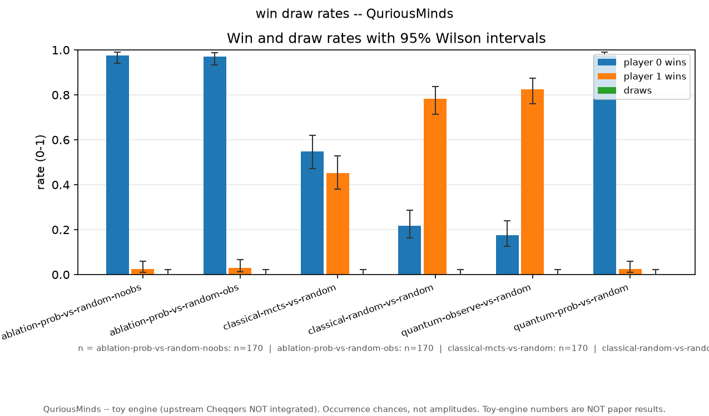
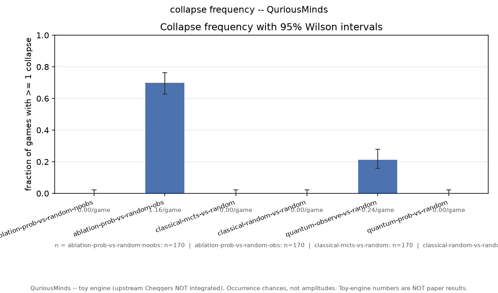
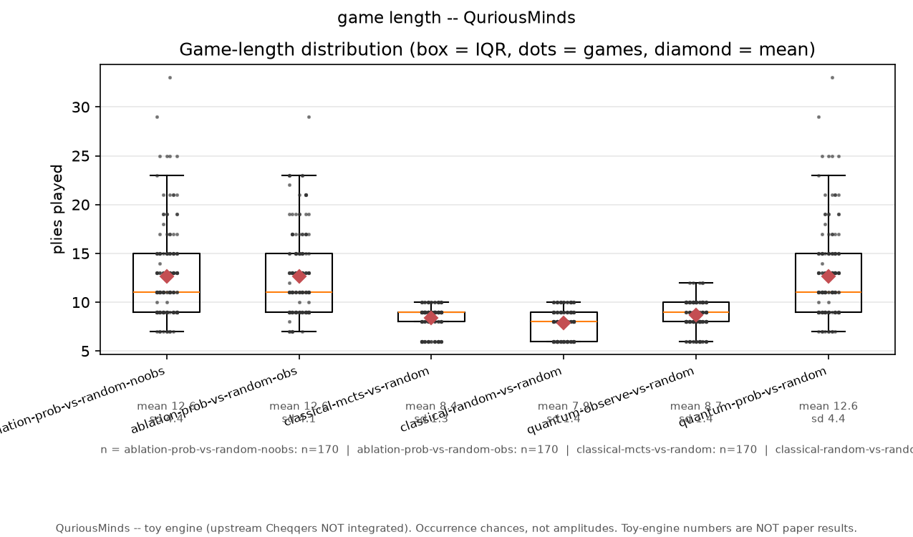
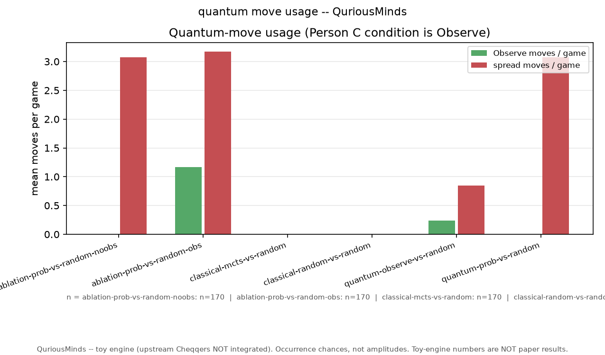

# QCheckers: Probability-Aware Search and Voluntary Measurement in a Quantum-Inspired Checkers Game

<div align="center">

**Project group:** QuriousMinds<br>
**Course:** IEG 313 — Quantum Computing for Engineers<br>
**Department:** [Department name]<br>
**Institution:** [Institution name]<br>
**Academic year:** [Academic year]

**Institute logo:** [Insert the official institution logo here]

| Student name | Register number |
| --- | --- |
| [Student 1] | [Register number] |
| [Student 2] | [Register number] |
| [Student 3] | [Register number] |
| [Student 4] | [Register number] |
| [Student 5] | [Register number] |

**Instructor(s):** [Instructor name(s)]

**Submission date:** [Date]

</div>

---

## Abstract

This report documents an archived experiment on the project's 4×4, probability-only
`DeterministicToyEngine`, inspired by Raat *et al.* [1]. The matched comparison asked
whether allowing voluntary Observe changed outcomes when the same legacy
probability-aware MCTS agent played against random, using 170 games per arm. The
estimated win-rate difference was −0.006 (95% interval [−0.046, +0.033]), which
includes zero. This experiment did not detect a win-rate effect. The archive contains
1,020 records that regenerate byte-for-byte from their recorded seeds. The legacy
probability-aware agent combines chance-weighted material, normalized progress and
chance-weighted rollout sampling; the comparison is not an uncertainty-only evaluation
of that agent against its baseline. The current local game server separately defaults
to `PaperQuantumEngine`, an independent CPU complex-amplitude implementation. It was
not used to produce these archived results. An optional IBM measurement-sampling path is
also present; it does not imply a persistent board state on quantum hardware. The
archived results remain bounded by the toy
engine's rules, board size, search configuration and narrow literature search.

**Keywords:** quantum checkers, Monte Carlo Tree Search, archived toy-engine study,
measurement, reproducibility, complex amplitudes

## Contents

1. [Introduction](#1-introduction)
2. [Literature review](#2-literature-review)
3. [Novelty and project contributions](#3-novelty-and-project-contributions)
4. [Methodology and system design](#4-methodology-and-system-design)
5. [Implementation](#5-implementation)
6. [Experimental design](#6-experimental-design)
7. [Results and discussion](#7-results-and-discussion)
8. [QCheckers demonstration](#8-qcheckers-demonstration)
9. [Conclusion and future work](#9-conclusion-and-future-work)
10. [Team contributions](#10-team-contributions)
11. [References](#11-references)
12. [Appendices](#12-appendices)

### List of figures

1. [QCheckers and research system architecture](#figure-1-system-architecture)
2. [Experiment and game execution workflow](#figure-2-execution-workflow)
3. [Baseline win and draw rates](#figure-3-baseline-rates)
4. [Collapse frequency](#figure-4-collapse-frequency)
5. [Game length](#figure-5-game-length)
6. [Quantum move usage](#figure-6-quantum-move-usage)
7. [QCheckers landing page](#figure-7-landing-page)
8. [QCheckers Stage 2 board after a split](#figure-8-game-board)

### List of tables

1. [Related work comparison](#table-1-related-work)
2. [Project changes relative to the research anchor](#table-2-project-changes)
3. [Software and computing environment](#table-3-environment)
4. [Baseline experimental results](#table-4-baselines)
5. [Matched ablation results](#table-5-ablation)
6. [Team contribution record](#table-6-contributions)

### Abbreviations

| Abbreviation | Meaning |
| --- | --- |
| API | Application Programming Interface |
| IBM | International Business Machines |
| IEEE | Institute of Electrical and Electronics Engineers |
| JSONL | JSON Lines record format |
| MCTS | Monte Carlo Tree Search |
| UCT | Upper Confidence bounds applied to Trees |
| UI | User Interface |
| WebSocket | Persistent, bidirectional browser/server connection |

## 1. Introduction

Quantum games use game rules or presentation to help players reason about quantum
phenomena. Raat *et al.* introduced quantum checkers as a staged game and as a setting
for studying AI agents [1]. Their work combines checkers with superposition,
measurement, entanglement and interference. This project uses that paper as its
research anchor and studies a small, independent probability-based model.

### 1.1 Problem statement and motivation

The reference paper describes an MCTS agent that averages outcomes across rollouts and
identifies probability-informed averaging as possible future work [1]. We examine a
small, controlled variation of that idea. We also ask whether giving an agent a
voluntary measurement action changes its game outcomes. These questions fit a
course-scale project because the game state can be simulated repeatedly with fixed
seeds and checked by replay.

### 1.2 Objectives

- For the archived study, implement a seeded, probability-only toy engine and a common
  engine interface.
- In that archived study, compare the frozen baseline and probability-aware agents
  under matched experimental conditions.
- Measure the effect of enabling voluntary Observe in the archived toy engine's matched
  ablation; the current paper engine offers voluntary Observe only at custom Level 4.
- Encode a candidate-square distribution as a one-shot measurement circuit for the
  optional IBM hardware path.
- Deliver QCheckers as a browser game and document the limits between the game model,
  the hardware collapse path and the reference paper.

### 1.3 Scope

The reported experiment uses the archived 4×4 `DeterministicToyEngine` and classical
probabilities; it does not represent amplitudes or phase. The current local server
defaults to a separate `PaperQuantumEngine`, which stores and evolves sparse complex
amplitudes on the CPU. The upstream Cheqqers code is still not integrated, and the
archived experiment is not a reproduction of the paper's numerical results. Optional
IBM integration supplies a measurement sample for a collapse; it does not store or
evolve a persistent board state on a QPU (section 4.7). The hosted deployment's engine
revision has not been verified against this local source. See
[`RULE_CONFORMANCE.md`](RULE_CONFORMANCE.md) for the paper-to-code mapping.

## 2. Literature review

### 2.1 Quantum games and educational mechanics

Piispanen *et al.* survey games that reference quantum physics or use quantum
principles, and propose a framework for describing their perceivable, technological
and scientific-purpose dimensions [2]. Their review helps distinguish a game that
teaches quantum ideas from a game whose computation is itself quantum. The archived
research engine is classical probability software; the current local paper engine
stores complex amplitudes on the CPU. Neither is the upstream implementation.

Cantwell presents Quantum Chess as a game built on unitary dynamics, with non-trivial
superposition, entanglement and interference [3]. That work illustrates a physically
motivated design direction. The reference checkers paper similarly integrates quantum
phenomena into a board game and additionally studies game complexity and AI play [1].
Both works are broader quantum-game designs than the archived toy engine. The local
paper engine implements complex-state mechanics from the cited rules, with explicit
modeling choices and limits documented in [`RULE_CONFORMANCE.md`](RULE_CONFORMANCE.md).

### 2.2 Search and probability-aware evaluation

UCT applies multi-armed bandit selection to Monte Carlo planning [4]. It provides the
tree-selection baseline used by the project. The source paper's MCTS uses rollout
averaging and explicitly suggests probability-based averaging as future work [1]. Our
archived `ProbAwareAgent` changes both material evaluation and rollout sampling. Its
material term weights site values by occupancy probability and includes normalized
progress within that expected score; it also adds the separate advance term and
chance-weighted rollout action sampling. It does not isolate uncertainty handling from
progress evaluation. These legacy-agent details do not describe the current live MCTS
evaluation. This is a project-level implementation of a direction suggested by the
paper; the available literature search is not broad enough to claim global novelty.

The paper's linked implementation is consulted only as a read-only code reference [8].

### 2.3 Gap addressed and limits of the review

The archived baseline comparison contrasts a maximum-occupancy MCTS with a legacy
`ProbAwareAgent` that also changes normalized-progress scoring and rollout action
sampling. Its matched Observe on/off ablation holds that same agent fixed and changes
only Observe availability. These experiments evaluate those choices in the independent
toy engine under a reproducible small-scale protocol, not the current paper engine. A
targeted search was recorded in [REPRODUCIBILITY.md](REPRODUCIBILITY.md)
§8, but it was not a systematic review. Similar work may exist; no claim of priority or
general novelty is made.

<a id="table-1-related-work"></a>

| Work | Focus and method | Limitation for this project | How it informs QCheckers |
| --- | --- | --- | --- |
| Raat *et al.* [1] | Staged quantum checkers; game analysis and random/MCTS agents | Reference implementation uses richer quantum state mechanics; our toy rules and search budget differ | Primary research anchor; motivates the probability-aware search question |
| Piispanen *et al.* [2] | Survey and conceptual framework for quantum games | A taxonomy, not a direct evaluation of this checkers engine or agent | Frames the educational purpose and distinguishes game mechanics from quantum computation |
| Cantwell [3] | Quantum Chess built from unitary dynamics | Different board game and formal model | Example of a richer, physically grounded quantum-game design |
| Kocsis and Szepesvári [4] | UCT selection for Monte Carlo planning | General planning method; not specific to probabilistic checkers | Supplies the MCTS selection baseline |

*Table 1. Related work and its role in this project.*

## 3. Novelty and project contributions

The work is based on the quantum-checkers design of Raat *et al.* [1]. The project
contribution is the implementation and evaluation described below, not the original
game, the general MCTS algorithm, or a claim to have originated quantum checkers.

<a id="table-2-project-changes"></a>

| Existing work or baseline | Project change | Evidence and boundary |
| --- | --- | --- |
| Reference game measures on capture attempts [1] | Add an optional Observe action to the archived toy experiment engine; add custom Level 4 Observe to the local paper engine | The archived Observe on/off comparison uses the same `ProbAwareAgent` in both arms; local paper-engine Observe is custom Level 4 only |
| Baseline material score values a spread piece by its maximum occupancy chance | Legacy `ProbAwareAgent` uses chance-weighted site values, normalized progress and chance-weighted rollout actions | This changes more than uncertainty weighting alone; the Observe ablation does not estimate the isolated effect of the full agent heuristic |
| Paper suggests probability-informed rollout valuation as future work [1] | Archived study tests one probability-aware search design on the 4×4 toy engine; current live play has a separate state-tree agent | Archived win-rate interval includes zero; no strength claim is made for the live paper-engine agent |
| Game paper provides its own game and AI analysis [1] | Build QCheckers as a browser teaching/demo interface with a local paper-based engine | Independent implementation; not upstream Cheqqers and not the source of archived study results |
| Probability-only board model cannot represent relative phase | Add a CPU sparse complex-amplitude engine and an optional one-shot IBM measurement path | The QPU supplies a collapse sample only; the persistent board state stays on the CPU |

*Table 2. Project changes relative to the cited research anchor.*

The two research ideas are candidate contributions **relative to the reference
implementation**, not verified field-wide novelties. The novelty search remains
targeted and incomplete. The web application and the optional hardware-sampling path are
engineering deliverables; neither expands the experimental claims.

## 4. Methodology and system design

### 4.1 Game-state model

The archived toy engine represents a piece by weighted candidate squares. For a piece (i),
let (S_i) be its possible sites and (p_{i,s}) the occupancy weight at square
(s\in S_i), with weights summing to one. A split creates a distribution over the
origin and available forward diagonals. These values are classical probabilities,
not complex amplitudes. Captures and the historical Observe option resolve uncertainty
using the engine's seeded random source. This section describes archived batches only;
the local gameplay model is the sparse complex-state `PaperQuantumEngine` summarized in
[`RULE_CONFORMANCE.md`](RULE_CONFORMANCE.md).

### 4.2 Search methods

The baseline uses UCT selection. For an action (a), accumulated value (W_a), visit
count (N_a), parent visit count (N) and exploration constant (c), it selects using

\[
\operatorname{UCT}(a)=\frac{W_a}{N_a}+c\sqrt{\frac{\ln N}{N_a}}.
\]

For the archived toy runs, the baseline uses \(c=\sqrt{2}\), 24 iterations per decision, a two-ply shallow search
and seeded rollouts. A spread piece contributes its maximum occupancy weight to the
baseline material term. The probability-aware search changes this term to

\[
M_{\mathrm{expected}}(i)=\sum_{s\in S_i}p_{i,s}\left(1+g_i(s)\right),
\]

where \(g_i(s)\) is the normalized progress value of site \(s\) for piece \(i\).
The baseline instead uses the largest occupancy weight as its material term. The
legacy probability-aware evaluator adds normalized site progress inside the expected
site value as well as its separate advance bonus; its rollout policy also samples legal
piece actions in proportion to the chance of occupying the acting square. The
baseline's exploration constant and capture penalty were kept matched, but this was not
a one-variable uncertainty-only comparison. This describes the frozen research code,
not the current live MCTS implementation or the reference paper's exact algorithm.

### 4.3 Statistical method

For a binary outcome with \(x\) successes in \(n\) games, the point estimate is
\(\hat p=x/n\). We report the 95% Wilson score interval [5], using \(z=1.96\):

\[
\frac{\hat p+z^2/(2n)\;\pm\;z\sqrt{\hat p(1-\hat p)/n+z^2/(4n^2)}}
     {1+z^2/n}.
\]

The comparison interval for independent proportions follows Newcombe's method [6].
All agents and engines use controlled seeds. The verifier reconstructs each experiment
record from its seed and logged parameters and requires byte-identical output.

### 4.4 System architecture

The paths use two separate engines. Archived experiment scripts use
`DeterministicToyEngine` and frozen legacy agents. The local FastAPI server defaults to
`PaperQuantumEngine` and `LiveMCTSAgent`; the Next.js client displays its marginals and
sends actions. The upstream Cheqqers engine is not integrated. The optional IBM
measurement path supplies one-shot collapse samples; it is not a third game engine.
Detailed boundaries are in [`RULE_CONFORMANCE.md`](RULE_CONFORMANCE.md).

<a id="figure-1-system-architecture"></a>


*Figure 1. Historical architecture for the archived toy-engine study. Current local gameplay uses the paper-based engine and live search; it is separate from the archived batch path. The optional IBM measurement sample is independent of both.*

### 4.5 Execution workflow

<a id="figure-2-execution-workflow"></a>


*Figure 2. Research and browser-game execution workflows.*

### 4.6 Collapse measurement circuit

A live collapse is encoded as a fresh measurement circuit by
`qcheckers/quantum/game_measure.py` [7]: one qubit per bit needed for the candidate count,
one basis state per candidate square with amplitude \(\sqrt{p_s}\), and a terminal
measurement. The circuit prepares exactly the candidate-square distribution stored by
the CPU engine; it does not prepare the full board state. The measured bitstring maps
back to a square by basis-state index (`|00>` = first site, `|01>` = second, and so on).
The circuit is submitted as exactly one shot, and every collapse re-prepares a fresh
circuit; no qubit stays loaded between turns. If the shot returns a basis state that
maps to no candidate square, the move is refused rather than substituting a value.

### 4.7 Optional IBM measurement sampling

The current local paper engine evolves the complete sparse complex-amplitude board
state on the CPU. When the optional IBM integration is configured, the engine can send
the candidate-square distribution for a single collapse to IBM Quantum and use one
measurement shot to select the projected square. The returned sample updates the
CPU-held state; it does not transfer the board to a QPU or preserve a quantum state
between turns. Ordinary moves, splits, entanglement and merge/interference remain CPU
state transitions. Level 1–3 measurements follow capture rules; custom Level 4 also has
voluntary Observe and decoherence collapse. The measurement circuit in section 4.6 is
used only to sample this collapse; it does not hold the state.

The hardware boundary has been tested against a mocked provider; no real QPU job
produced or validated the results in this report, and one later one-shot job
(19 October 2026, recorded in [`docs/HANDOFF.md`](HANDOFF.md)) confirms only the live
path. Without a
sampler, collapse uses the engine's seeded local RNG. A failed or timed-out job is
refused with `quantum_unavailable`; a bitstring that maps to no candidate square is
refused with `quantum_invalid_outcome`. Either way the action is refused without
committing a partial state. See
[`HARDWARE_COLLAPSE.md`](HARDWARE_COLLAPSE.md) and
[`RULE_CONFORMANCE.md`](RULE_CONFORMANCE.md).

## 5. Implementation

### 5.1 Software and computing environment

<a id="table-3-environment"></a>

| Area | Implementation |
| --- | --- |
| Archived experiment engine | `DeterministicToyEngine`; 4×4 probability-only state and seeded standard-library randomness |
| Current local gameplay engine | `PaperQuantumEngine`; sparse joint complex amplitudes on CPU, branch cap 4,096 |
| Archived agent search | Frozen legacy UCT baseline and `ProbAwareAgent`; 24 iterations per move |
| Current local live search | State-tree UCT; room tiers use 200/400 iterations, depth 4, rollout cap 8 and deterministic branch-work limit |
| Experiment records | JSON Lines with frozen schema, seeds and parameters |
| Statistical analysis | Python; Wilson score intervals and Newcombe difference intervals |
| Collapse measurement circuit | `qcheckers/quantum/game_measure.py`; one measurement shot per collapse, not used for reported results |
| Live QPU collapse (opt-in) | Qiskit + qiskit-ibm-runtime; one shot per collapse when `QISKIT_IBM_TOKEN` is set, else disabled |
| Backend | FastAPI and Uvicorn; WebSocket game state; Google Cloud Run, asia-south1 |
| Browser client | Next.js 16, React 19 and TypeScript; Vercel deployment |
| Test environment recorded | Windows 11, Python 3.13.5, Node.js 22.16, npm 11.6 |
| Quantum hardware | None used for archived results; optional local gameplay integration uses IBM only to sample a collapse, not to hold the board state |

*Table 3. Software and computing environment recorded for the submission.*

No external game dataset is used. The experiment dataset consists of seeded game
records generated by the project. The checked-in result figures are regenerated from
the six registered conditions; human browser games are excluded from batch analysis.

### 5.2 Development and deployment

The engine, agent and log schema were implemented first, followed by seeded experiment
scripts and a byte-identity verifier. The browser client and server use the same engine
and frozen message protocol. Deployment uses a public Next.js frontend and a public
Cloud Run API. The service currently stores game rooms in memory and is limited to one
instance; a service restart or redeployment clears active rooms. Full deployment
configuration and setup instructions are in [DEPLOYMENT.md](DEPLOYMENT.md).

### 5.3 Test and verification evidence

The recorded 12 October 2026 verification snapshot had 270 passing Python tests, a
passing TypeScript typecheck, six passing client checks and a successful Next.js
production build. The current local source has since added a paper engine and live
server path; see `HANDOFF.md` for the latest test count. The 57/57 browser checks,
1020/1020 deterministic experiment replay, and hosted deployment checks are historical;
the browser and hosted checks were not rerun for the current paper-engine source. The
hosted deployment's active engine was not verified, and no real IBM hardware job was
part of these checks; the single later one-shot job is noted in
[`docs/HANDOFF.md`](HANDOFF.md). These checks verify
implementation behavior; they do not establish statistical power beyond the stated
experimental design or broad novelty.

## 6. Experimental design

### 6.1 Research question

In the archived toy-engine study, under its probability-only 4×4 rules and fixed
agent/search budget, does enabling voluntary Observe change the legacy
probability-aware agent's win rate against the same random opponent? This is not a
question about the current `PaperQuantumEngine` or live agent.

### 6.2 Conditions and controls

The archived toy-engine ablation compares `ablation-prob-vs-random-obs` with
`ablation-prob-vs-random-noobs`. Both arms use level 2 of the project's experimental
configuration, the same 170 seeds (0–169), the same opponent, agent, search budget and
engine. The only configured difference is whether this historical engine allows
voluntary Observe. Both arms use the same legacy `ProbAwareAgent`, whose evaluation
includes chance-weighted material and normalized progress and whose rollout policy is
also chance-weighted. This comparison tests Observe availability conditional on that
heuristic; it does not isolate uncertainty handling from progress scoring. Four
baseline conditions use 170 games each: classical-random, classical-MCTS,
quantum-observe and quantum-probability-aware, each against random. Total: 1,020
batch games.

### 6.3 Outcomes

Primary outcome: player 0 win rate. Secondary outcomes: player 1 win rate, draw rate,
collapse rate, mean game length and Observe moves per game. We report point estimates
and 95% intervals where applicable. The engine has no 40-move draw rule, so observed
draw rates of zero are structural for this archived configuration and should not be interpreted
as a general property of quantum checkers.

## 7. Results and discussion

All tables and figures in this section report the archived `DeterministicToyEngine`
batch dataset. They do not describe games from the local `PaperQuantumEngine`, its live
agent, or the upstream Cheqqers implementation.

### 7.1 Baseline conditions

<a id="table-4-baselines"></a>

| Condition (n=170 each) | Player 0 win rate [95% Wilson interval] | Collapse rate | Mean length (plies) | Throughput (games/s) |
| --- | --- | --- | --- | ---: |
| Classical random vs random | 0.218 [0.162, 0.286] | 0.000 | 7.90 | 1,984 |
| Classical MCTS vs random | 0.547 [0.472, 0.620] | 0.000 | 8.42 | 56 |
| Quantum Observe vs random | 0.176 [0.127, 0.241] | 0.212 | 8.66 | 1,477 |
| Quantum probability-aware vs random | 0.976 [0.941, 0.991] | 0.000 | 12.62 | 13.8 |

*Table 4. Archived baseline results for the 4×4 toy engine. Throughput was measured on the recorded laptop and is environment-dependent. The “quantum” labels refer to that historical probability model, not the local paper engine.*

<a id="figure-3-baseline-rates"></a>



*Figure 3. Baseline win and draw rates; each arm contains 170 games.*

<a id="figure-4-collapse-frequency"></a>



*Figure 4. Collapse frequency by condition.*

<a id="figure-5-game-length"></a>



*Figure 5. Mean game length by condition.*

<a id="figure-6-quantum-move-usage"></a>



*Figure 6. Use of spread and measurement actions by condition.*

### 7.2 Matched Observe ablation

<a id="table-5-ablation"></a>

| Metric | Observe enabled | Observe disabled | Difference (enabled − disabled) |
| --- | --- | --- | --- |
| Player 0 win rate | 0.971 [0.933, 0.987] | 0.976 [0.941, 0.991] | −0.006 [−0.046, +0.033] |
| Collapse rate | 0.700 [0.627, 0.764] | 0.000 [0.000, 0.022] | +0.700 [+0.624, +0.764] |
| Observe moves/game | 1.16 | 0.00 | — |
| Mean length (plies) | 12.63 | 12.62 | — |

*Table 5. Archived matched Observe-availability ablation, 170 games per arm, using the same legacy `ProbAwareAgent` in each arm.*

The win-rate difference interval includes zero, so the experiment did not detect a
win-rate effect at this sample size, board size and search budget. The large increase
in collapse rate is expected because enabling Observe creates more measurement events;
it is not evidence of stronger play. The Observe-only baseline loses to random at a
rate reflected by player 0's 0.176 win estimate, consistent with the tempo cost of
spending a full turn to resolve one's own piece. Probability-aware search has a high
win estimate in this toy engine, but the result does not compare with the source
paper's larger board, rules or 200/400/800-rollout agents.

### 7.3 Interpretation and threats to validity

- **Model validity:** these archived results use the 4×4 probability model and its
  documented differences from the paper. They do not evaluate the later local
  `PaperQuantumEngine` and do not reproduce the paper's values.
- **Search budget:** the baseline uses 24 iterations and (c=\sqrt{2}), while the
  paper reports larger search budgets. Agent-strength comparisons with that work are
  out of scope.
- **Sample size:** 170 games per arm leaves an interval wide enough to include both
  modest negative and positive effects. The null result is not proof of equivalence.
- **Agent matchup:** the probability-aware arm is much stronger than random in this
  specific engine; opponent strength and heuristic interactions limit external
  validity.
- **Reproducibility:** fixed seeds and byte-identical replay make these runs
  reproducible; deterministic repetition does not remove model bias.
- **Novelty:** the related-work search was targeted rather than systematic.
- **Human evaluation:** no participant study or usability evaluation was conducted; browser checks are functional checks, not evidence of learning outcomes.

## 8. QCheckers demonstration

QCheckers is a server-authoritative browser game with a lobby, reconnectable seats,
stage-specific rules, probability labels and separate music and sound controls. The
current local server source defaults to `PaperQuantumEngine` with `LiveMCTSAgent`; it
is distinct from the 4×4 toy engine that generated the report's archived results and
is not the upstream Cheqqers software. The hosted deployment's engine revision was not
verified against this local source snapshot.

<a id="figure-7-landing-page"></a>


*Figure 7. Current QCheckers landing page captured from localhost on 15 October 2026.*

<a id="figure-8-game-board"></a>


*Figure 8. Current Stage 2 (engine Level 1) paper-engine board captured from localhost on 15 October 2026. A split moves one piece to two 50% candidate squares. The board shows occupancy marginals; the complete complex state remains in the CPU engine.*

The production demo is available at [quriousminds.vercel.app](https://quriousminds.vercel.app).
The frontend is hosted on Vercel and the FastAPI/WebSocket backend on Google Cloud
Run. Active rooms are held in memory, so a Cloud Run restart clears them. Music uses a
CC0 ambient loop with attribution in [ATTRIBUTION.md](ATTRIBUTION.md).

## 9. Conclusion and future work

The archived study delivered a reproducible probability-only engine, legacy search
agents and a matched Observe-availability ablation. All 1,020 experiment games
regenerate byte-for-byte from their records. In that archived comparison, Observe
changed collapse frequency but did not produce a detectable win-rate change: the 95%
difference interval includes zero. The current local `PaperQuantumEngine` and live
MCTS agent are separate implementations and were not evaluated in those batches. This
report's conclusions are limited to the toy engine, board, matchup, sample size and
search budget.

Next research steps include evaluating the local paper engine and live agent under a
separate, controlled protocol, broadening the literature review, and conducting
accessibility/user testing. Further engineering work could add persistent room storage.
The optional IBM path samples a collapse only; the complex board state remains in the
CPU engine. No result in this report comes from real hardware; the single recorded
one-shot job (see [`docs/HANDOFF.md`](HANDOFF.md)) confirms only the live path. See
section 4.7 and
[`RULE_CONFORMANCE.md`](RULE_CONFORMANCE.md).

## 10. Team contributions

The source tree records five technical work areas. The following table preserves that
division while leaving identity and confirmation of individual completed tasks for the
team to provide. Replace each role code with the member's name and register number,
then revise the responsibility text to match the work that member actually completed.

<a id="table-6-contributions"></a>

| Member and register number | Recorded responsibility area |
| --- | --- |
| [P1 name] — [register number] | Agent framework and search, experiment direction, and novelty verification |
| [P2 name] — [register number] | Statistical analysis, experiment configuration and plots |
| [P3 name] — [register number] | Replay payload and reproducibility materials |
| [P4 name] — [register number] | Browser client/viewer and related-work materials |
| [P5 name] — [register number] | Engine contract and toy engine, experiment harness and integration |

*Table 6. Technical role areas recorded in the repository's team plan. Confirm individual ownership and completed tasks before submission.*

## 11. References

[1] M. Raat, L. van den Nouweland, M. Müller-Brockhausen, M. Preuss, and E. van
Nieuwenburg, “Quantum Checkers: The Development and Analysis of a Quantum Combinatorial
Game,” in *2025 IEEE Conference on Games (CoG)*, 2025, pp. 1–8, doi:
[10.1109/CoG64752.2025.11114278](https://doi.org/10.1109/CoG64752.2025.11114278). Preprint:
[arXiv:2506.05962](https://arxiv.org/abs/2506.05962).

[2] L. Piispanen, M. Pfaffhauser, J. Wootton, J. Togelius, and A. Kultima, “Defining
quantum games,” *EPJ Quantum Technology*, vol. 12, art. 7, 2025, doi:
[10.1140/epjqt/s40507-025-00308-7](https://doi.org/10.1140/epjqt/s40507-025-00308-7).

[3] C. Cantwell, “Quantum Chess: Developing a Mathematical Framework and Design
Methodology for Creating Quantum Games,” arXiv:1906.05836 [quant-ph], 2019.
[Online]. Available: https://arxiv.org/abs/1906.05836.

[4] L. Kocsis and C. Szepesvári, “Bandit based Monte-Carlo planning,” in *Machine
Learning: ECML 2006*, Lecture Notes in Computer Science, vol. 4212, 2006,
pp. 282–293, doi: [10.1007/11871842_29](https://doi.org/10.1007/11871842_29).

[5] E. B. Wilson, “Probable inference, the law of succession, and statistical
inference,” *Journal of the American Statistical Association*, vol. 22, no. 158,
pp. 209–212, 1927, doi: [10.1080/01621459.1927.10502953](https://doi.org/10.1080/01621459.1927.10502953).

[6] R. G. Newcombe, “Interval estimation for the difference between independent
proportions: comparison of eleven methods,” *Statistics in Medicine*, vol. 17, no. 8,
pp. 873–890, 1998, doi: [10.1002/(SICI)1097-0258(19980430)17:8%3C873::AID-SIM779%3E3.0.CO;2-I](https://doi.org/10.1002/(SICI)1097-0258(19980430)17:8%3C873::AID-SIM779%3E3.0.CO;2-I).

[7] Qiskit contributors, “Qiskit documentation.” [Online]. Available:
https://quantum.cloud.ibm.com/docs/en/guides.

[8] M. Raat *et al.*, “Cheqqers,” source repository, paper-related code reference,
[github.com/raatmarien/cheqqers](https://github.com/raatmarien/cheqqers). Accessed
October 2026. Read-only reference; no code copied or integrated.

## 12. Appendices

### Appendix A. Quick start and player instructions

1. Open [QCheckers](https://quriousminds.vercel.app) in a modern browser.
2. Select **Start a game**, choose a stage and opponent, then select **Create game**.
3. Levels 0–3 in local paper-rules mode use the paper-based movement, split,
   entanglement and interference model. Level 4 is the project's custom
   decoherence/Observe extension.
4. The board renders occupancy marginals derived from the CPU-held complex state; it
   does not expose raw amplitudes or phases. When configured, IBM hardware supplies a
   collapse sample only. See [`RULE_CONFORMANCE.md`](RULE_CONFORMANCE.md) for the
   implementation boundary.
5. Use the **Music** control independently from sound effects. Soundtrack credit and
   license are recorded in [ATTRIBUTION.md](ATTRIBUTION.md).
6. For a two-browser game, select **Online** and share the lobby code with the other
   player. A room remains available only while the single Cloud Run instance retains
   it in memory.

### Appendix B. Reproduction commands

From the repository root, install Python dependencies with
`python -m pip install -r requirements.txt`. Install the web client with
`cd client; npm ci`. The main reproducibility commands are:

```text
python -m pytest -q
python scripts/run_baseline.py --condition quantum-prob-vs-random -n 170
python scripts/run_ablation.py --agent-a prob --agent-b random -n 170 --write-logs
python scripts/make_plots.py
python scripts/verify_results.py --json results/verification.json
python scripts/browser_check.py
```

The environment, log format, and detailed run instructions are recorded in
[REPRODUCIBILITY.md](REPRODUCIBILITY.md), [README.md](../README.md), and
[DEPLOYMENT.md](DEPLOYMENT.md).

### Appendix C. Contribution completion note

The contribution table in §10 is a role-based draft from the repository plan, not a
substitute for a team-authored record of each person's completed work. Confirm it with
all group members before submission.
